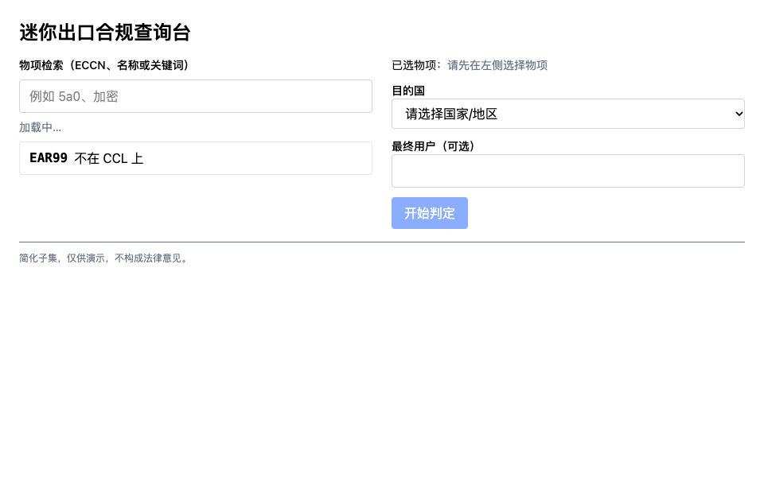
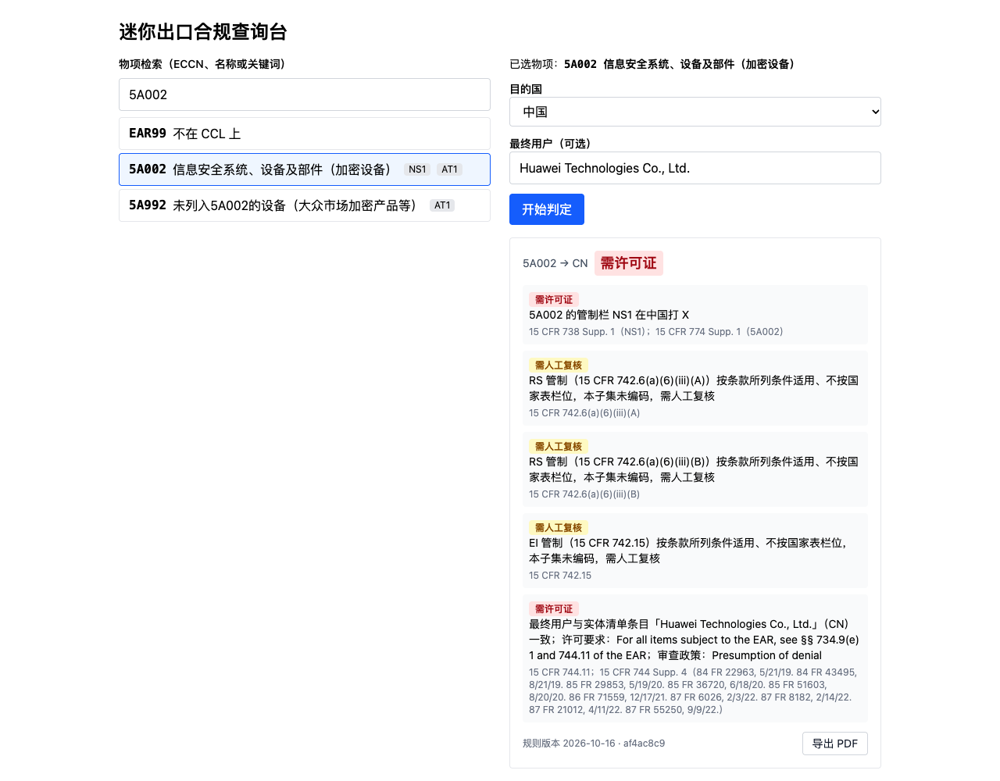
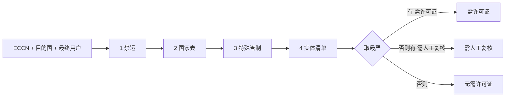

# 迷你出口合规查询台

在美国 EAR（出口管理条例）的简化子集上，对「物项 + 目的国 + 最终用户」给出出口许可初筛结论，并导出可复现的 PDF 报告。物项检索页 + 规则匹配 API + PDF 报告导出，单容器交付。





> 简化子集，仅供演示，不构成法律意见。

## 快速开始

需要 Docker。

```bash
docker compose up --build
```

打开 http://localhost:8000 。接口文档在 http://localhost:8000/docs 。

可以直接试这几组输入：

| 物项 | 目的国 | 最终用户 | 结论 |
|---|---|---|---|
| 5A002 | 中国 | （空） | 需许可证 |
| 5A991 | 日本 | （空） | 无需许可证 |
| 5A002 | 加拿大 | （空） | 需人工复核 |
| 5A991 | 日本 | Huawei Technologies Co., Ltd. | 需许可证 |
| 5A991 | 日本 | Huawei | 需人工复核 |

## 判定逻辑

每次判定按固定顺序走四步，**触发的步骤都会留下依据，包括未命中**：国家表总会留依据；禁运、特殊管制、实体清单只在触发时留（目的国禁运；物项带特殊管制；填了最终用户）。唯一的省略情形见下，最终结论取所有依据中最严的一档。

| 步骤 | 条件 | 依据结论 |
|---|---|---|
| 1 禁运 | 目的国在禁运名单（古巴、伊朗、朝鲜、叙利亚、俄罗斯、白俄罗斯等） | 需许可证 |
| 2 国家表 | ECCN 的管制栏在目的国打 X（每个命中栏一条）；否则一条「未命中」（物项有管制栏、目的国禁运时省略，见下）；EAR99 直接无需许可证 | 需许可证 / 无需许可证 |
| 3 特殊管制 | ECCN 带有国家表里没有对应栏的管制（RS 的部分情形、EI 等），每项一条 | 需人工复核 |
| 4 实体清单 | 填了最终用户才执行：规范化后完全一致 → 需许可证；相似度 ≥ 0.85 或名称部分重合 → 需人工复核；其他 → 无需许可证 | 三档皆可 |



三档严重度：需许可证 > 需人工复核 > 无需许可证。唯一的省略：物项有国家表管制栏（不是 EAR99，`controls` 非空）、目的国禁运、且这些栏在该国都没打 X 时，不写国家表依据行，因为禁运那条已经决定了结论。其余情形照常写：命中（含俄罗斯、白俄罗斯）、EAR99 的「不受国家表管制」、无管制栏 ECCN（3A999、5A980）的「无国家表管制栏」。古巴、伊朗、朝鲜、叙利亚的国家表行本身为空（`x_columns` 为空），eCFR 改由 Part 746 管制，所以对它们的有管制栏物项必然落入省略；俄罗斯、白俄罗斯的行有 X 栏，只有未命中才省略。

## 数据来源与版本

数据手工整理自 eCFR（2026-09-24 版），整理日期 2026-10-16：

- [15 CFR 774 Supp. 1（CCL）](https://www.ecfr.gov/current/title-15/subtitle-B/chapter-VII/subchapter-C/part-774/appendix-Supplement%20No.%201%20to%20Part%20774)
- [15 CFR 738 Supp. 1（国家表）](https://www.ecfr.gov/current/title-15/subtitle-B/chapter-VII/subchapter-C/part-738/appendix-Supplement%20No.%201%20to%20Part%20738)
- [15 CFR 744 Supp. 4（实体清单）](https://www.ecfr.gov/current/title-15/subtitle-B/chapter-VII/subchapter-C/part-744/appendix-Supplement%20No.%204%20to%20Part%20744)
- [15 CFR 746（禁运与特别管制）](https://www.ecfr.gov/current/title-15/subtitle-B/chapter-VII/subchapter-C/part-746)

规模：64 个 ECCN（第 3、4、5 类）、28 个国家、40 条实体清单记录。香港未收录——eCFR 国家表没有单独的香港行。

两个版本标识：

- `meta.version`：人读的规则集版本（整理日期），数据变更时手动更新，位于 `backend/data/meta.json`（另有 `ecfr_issue_date`）。
- `ruleset_digest`：启动时对三个数据文件（`ccl.json`、`country_chart.json`、`entity_list.json`）的原始字节算 sha256，取前 8 位十六进制。改了数据却忘了改版本号时，digest 仍会变，报告可复现性不会悄悄失真。

## 设计决策

### 1. 规则放数据文件，判定是纯函数

- **做了什么**：规则全部放 `backend/data/*.json`；`rules.py` 的 `check(ruleset, eccn, country, end_user)` 只用标准库，没有 Web 依赖，不读全局状态。
- **为什么**：规则会变、逻辑不常变，分开后改规则只改 JSON；纯函数用参数表直接测，不需要起服务。
- **代价**：JSON 是手工整理的，容易录错，靠数据完整性测试（栏位集合、ECCN 不重复、special_controls 必有出处）兜底，不能替代对照 eCFR 复核。
- **何时升级**：规则条数过千、或需要自动跟进 eCFR 更新时，加抓取与校验流水线，或进数据库。

### 2. 三档结论，不是通过/不通过

- **做了什么**：结论分「需许可证 / 需人工复核 / 无需许可证」；规则判断不了的情形（特殊管制、疑似实体匹配）明确落在「需人工复核」。
- **为什么**：子集规则不可能覆盖全部情形，判断不了就该说不确定；合规场景下误放行的代价远大于多一次人工复核。
- **代价**：「需人工复核」会偏多，例如 5A002 去加拿大：国家表没有命中，但带 RS/EI 特殊管制，就落在这一档。
- **何时升级**：把目的地条件编进规则（见下方已知简化），复核档才会收窄。

### 3. 判定轨迹：触发的步骤都留依据，包括未命中

- **做了什么**：每个触发的步骤产出 `Finding`（规则、结论、中文说明、条款出处）：国家表总有；禁运、特殊管制、实体清单仅在触发时有；实体清单一旦触发，命中或未命中都写一条（国家表的唯一省略情形见判定逻辑）。
- **为什么**：一份「无需许可证」的结论只有在能看出查过什么、查到什么时才可信；它同时就是 PDF 里的依据表，也方便写测试断言。
- **代价**：结果比只给结论啰嗦；有的 ECCN 会出现多条依据。
- **何时升级**：依据变多时前端按步骤折叠分组。

### 4. 后端生成 PDF，报告编号由输入和规则集决定

- **做了什么**：`POST /api/report` 用 Jinja2 + WeasyPrint 在服务端出 PDF。报告编号 = `sha256(json(规范化输入) + digest)` 的前 12 位十六进制，不含生成时间。
- **为什么**：HTML/CSS 排版比坐标绘图好维护，中文字体由镜像统一提供，不依赖用户浏览器；同输入 + 同规则得到同一编号，可以拿编号核对报告是否对应同一次判定。
- **代价**：镜像需装 pango 与 `fonts-noto-cjk`，体积变大；macOS 本地开发要 `brew install pango`。
- **何时升级**：并发量大时把 PDF 渲染放进队列；需要编号可追溯到具体一次查询时，才需要存储。

### 5. 无数据库

- **做了什么**：规则启动时加载进内存，后端无状态；导出 PDF 时用同样的输入重算一遍。
- **为什么**：规则只读、数据量很小；重算 + 确定性编号足以保证报告一致，省掉存储、迁移与数据保留问题。
- **代价**：没有查询历史和审计日志；检索是线性扫描。
- **何时升级**：需要审计记录、用户账号或条目上万时，换 SQLite（检索可用 FTS5），再视情况换 Postgres。

### 6. 单容器

- **做了什么**：多阶段 Dockerfile，先构建前端，再由 FastAPI 的 `StaticFiles` 托管构建产物，一个镜像、一个端口，非 root 运行。
- **为什么**：`docker compose up` 一条命令跑通，评审者不需要装 Node 或 Python。
- **代价**：前后端不能独立伸缩；改前端要重建镜像（开发期用 Vite 代理，不受影响）。
- **何时升级**：前端需要 CDN 或独立发布节奏时，拆成静态站点 + API 两个服务。

### 7. 不配 CORS

- **做了什么**：不加任何 CORS 中间件。开发期 Vite 把 `/api` 代理到 :8000，生产环境前端与 API 同源。
- **为什么**：同源就不需要跨域；不开 CORS 等于没有多余的攻击面，也没有「通配符放行」的隐患。
- **代价**：别的域名的页面无法直接调用该 API。
- **何时升级**：出现跨域的第三方调用方时，按白名单精确放行具体来源，不要 `*`。

### 8. 实体匹配：0.85 阈值 + 部分重合兜底

- **做了什么**：名称先规范化（casefold、去标点、去 Co/Ltd/Inc 等公司后缀）；完全一致 → 需许可证；`difflib.SequenceMatcher` 相似度 ≥ 0.85 → 需人工复核；否则做包含兜底（较短一方 ≥ 4 个字符且是较长一方的子串）→ 需人工复核；都不中 → 无需许可证。只比对英文名称与别名。
- **为什么**：先上无依赖的标准库方案。0.85 是经验值，基于字符序列。兜底是实测后加的：真实的 Huawei 条目没有单独的 "Huawei" 别名，只输入 "Huawei" 时相似度很低，会被判为未命中，这在合规场景不可接受。
- **代价**：阈值没有标注集校准，会有误报和漏报；中文名、中英混写不匹配；包含兜底会让常见词产生多余的复核。
- **何时升级**：换 rapidfuzz 的 `token_set_ratio`，建一个人工标注集来调阈值，并加入中文名与别名。

## 已知简化与下一步

范围上不做（也是下一步候选）：许可证例外（LVS/GBS/ENC 等）、先进计算专项规则（744.23 等）、ECCN 子段落级管制、最终用途管制、登录、查询日志与审计库、规则自动抓取更新、LLM/RAG 辅助归类、公网部署。

实现上的取舍：

- 任何禁运都按「需许可证」处理，包括俄罗斯、白俄罗斯的 `15 CFR 746.8`。746.8 对 EAR99 物项并非一概禁止，这里刻意偏保守。
- `special_controls` 里依赖目的地的管制（RS/NS/NP 对 Country Group D:1/D:4/D:5、SL、EI 等）没有编码，一律给「需人工复核」。
- 管制按整个 ECCN 记录，不细分到子段落（例如 `.z`）。
- 中文或中英混写的最终用户名称不会被匹配。
- 香港不在国家表子集内。

## 本地开发

### 后端

```bash
brew install pango          # macOS，WeasyPrint 依赖
cd backend
uv venv -p 3.12 .venv
uv pip install -r requirements-dev.txt
export DYLD_FALLBACK_LIBRARY_PATH=/opt/homebrew/lib   # macOS 找不到 pango 时需要；app.main 导入时就会加载 WeasyPrint，pytest 也一样
.venv/bin/uvicorn app.main:app --port 8000
.venv/bin/pytest
.venv/bin/ruff check .
```

### 前端

```bash
cd frontend
npm ci
npm run dev      # Vite，/api 代理到 :8000，需先启动后端
npm run lint     # oxlint
npm run build    # tsc -b && vite build
```

### 目录

```
backend/app/      main.py（API）· rules.py（判定）· report.py + templates/（PDF）
backend/data/     ccl.json · country_chart.json · entity_list.json · meta.json
backend/tests/    test_rules.py · test_api.py
frontend/src/     App.tsx · components/（ItemSearch · CheckForm · ResultCard）· api.ts · types.ts
Dockerfile · docker-compose.yml · .github/workflows/ci.yml
```

CI（`.github/workflows/ci.yml`）并行跑三个 job：后端 ruff + pytest、前端 lint + build、docker build。

## 免责声明

简化子集，仅供演示，不构成法律意见。
