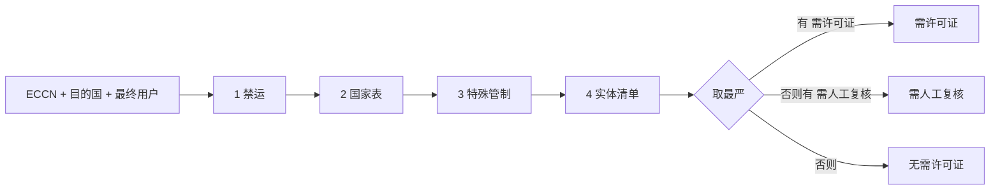

# 迷你出口合规查询台

输入要出口的物项（ECCN）、目的国和最终用户，它按美国 EAR（出口管理条例）的一个简化子集做许可初筛，给出「需许可证」「需人工复核」或「无需许可证」，并列出每条依据和对应条款。结果可以导出成 PDF 报告；同样的输入在同一版规则下，总是得到同一个报告编号。

前端 React + Vite，后端 FastAPI，PDF 用 WeasyPrint 生成，打包成一个 Docker 镜像。


> 简化子集，仅供演示，不构成法律意见。

## 快速开始

需要 Docker。

```bash
docker compose up --build
```

打开 http://localhost:8000 。接口文档在 http://localhost:8000/docs 。

下面几组输入覆盖了三种结论，可以直接试：

| 物项 | 目的国 | 最终用户 | 结论 | 原因 |
|---|---|---|---|---|
| 5A002 | 中国 | （空） | 需许可证 | NS1 栏在中国打 X，EI 管制也覆盖中国 |
| 5A991 | 日本 | （空） | 无需许可证 | 唯一的管制栏 AT1 在日本没打 X |
| 5A002 | 加拿大 | （空） | 需人工复核 | 国家表没命中，但 5A002.z 的先进计算管制覆盖加拿大，系统不知道物项是否属于 `.z` |
| 5A991 | 日本 | Huawei Technologies Co., Ltd. | 需许可证 | 与实体清单条目完全一致 |
| 5A991 | 日本 | Huawei | 需人工复核 | 与华为的条目部分重合，疑似命中 |

## 判定逻辑

每次判定按顺序查四步。每一步只要查了，就留下一条「依据」，写明结论和条款出处；查了没命中也留。这样即使结论是「无需许可证」，也看得出查过什么。最终结论取所有依据里最严的一档：需许可证 > 需人工复核 > 无需许可证。

| 步骤 | 什么时候查 | 怎么判 |
|---|---|---|
| 1 禁运 | 目的国在禁运名单（古巴、伊朗、朝鲜、叙利亚、俄罗斯、白俄罗斯） | 需许可证 |
| 2 国家表 | 每次都查（有一个例外，见表下） | 物项的某个管制栏在目的国打了 X → 需许可证，每个命中栏一条；都没打 X、物项没有管制栏或是 EAR99 → 无需许可证 |
| 3 特殊管制 | 物项带有不走国家表的管制（EI、SL，先进计算和半导体设备的 RS/NS 等） | 见下 |
| 4 实体清单 | 填了最终用户 | 见下 |



**国家表的例外**：如果目的国被禁运，而物项的管制栏在该国都没打 X，就不写国家表这条。禁运那条已经决定了结论，再写一条「无需许可证」只会让人困惑。古巴、伊朗、朝鲜、叙利亚在国家表里整行为空（eCFR 改由 Part 746 管制），所以发往这四国的物项只要有管制栏，这条就总是省略。俄罗斯、白俄罗斯有打 X 的栏，命中时照常写。

**特殊管制**每项单独判一条。条款的目的地范围按国家或国家组写，比如「D:1/D:4/D:5，但不含 A:5/A:6」：

- 目的国不在范围内 → 无需许可证
- 在范围内，且管的是整条 ECCN → 需许可证
- 在范围内，但只管某些子项（如 `.z`）→ 需人工复核，因为系统不知道你的物项是不是那个子项。如果该 ECCN 列出的子项在这个国家全部受控，那不管是哪一项都要许可证 → 需许可证
- 条款按最终用户或原产地适用，没法按目的地判断 → 需人工复核

**实体清单**只比对名称里的英文字母和数字（细节见[设计决策 8](#8-实体匹配085-阈值--部分重合兜底)）：

- 完全一致 → 需许可证
- 相似度 ≥ 0.85，或名称部分重合 → 需人工复核
- 名称里没有英文字母或数字（纯中文名，或只写了「Co., Ltd.」）→ 没法比对，需人工复核
- 其他 → 无需许可证

## 数据来源与版本

数据手工整理自 eCFR 2026-09-24 版，整理于 2026-10-16：

- [15 CFR 774 Supp. 1（CCL）](https://www.ecfr.gov/current/title-15/subtitle-B/chapter-VII/subchapter-C/part-774/appendix-Supplement%20No.%201%20to%20Part%20774)
- [15 CFR 738 Supp. 1（国家表）](https://www.ecfr.gov/current/title-15/subtitle-B/chapter-VII/subchapter-C/part-738/appendix-Supplement%20No.%201%20to%20Part%20738)
- [15 CFR 744 Supp. 4（实体清单）](https://www.ecfr.gov/current/title-15/subtitle-B/chapter-VII/subchapter-C/part-744/appendix-Supplement%20No.%204%20to%20Part%20744)
- [15 CFR 740 Supp. 1（国家组）](https://www.ecfr.gov/current/title-15/subtitle-B/chapter-VII/subchapter-C/part-740/appendix-Supplement%20No.%201%20to%20Part%20740)
- [15 CFR 742（特殊管制的目的地条件）](https://www.ecfr.gov/current/title-15/subtitle-B/chapter-VII/subchapter-C/part-742)
- [15 CFR 746（禁运与特别管制）](https://www.ecfr.gov/current/title-15/subtitle-B/chapter-VII/subchapter-C/part-746)

收录范围：

- 64 个 ECCN，来自第 3、4、5 类（电子、计算机、电信与信息安全）
- 28 个国家/地区，每个都带 A、D、E 国家组；台湾在界面中显示为「中国台湾」
- 40 条实体清单记录

香港没有收录：eCFR 国家表没有单独的香港行，EAR 自 2020 年起对香港按中国处理，查香港请选中国。

规则集有两个版本标识：

- `meta.version`：给人看的版本号，就是数据整理日期，改数据时手动更新。在 `backend/data/meta.json` 里，同一文件还有 `ecfr_issue_date`。
- `ruleset_digest`：启动时自动计算。把三个数据文件（`ccl.json`、`country_chart.json`、`entity_list.json`）的原始字节和规则引擎源码 `rules.py` 一起做 sha256，取前 8 位。改了数据或判定逻辑但忘了改版本号，digest 也会变，所以同一个报告编号不会对应两种不同的判定结果。

## 设计决策

### 1. 规则放数据文件，判定是纯函数

- **做了什么**：规则都放在 `backend/data/*.json`。判定入口是 `rules.py` 的 `check(ruleset, eccn, country, end_user)`，只用标准库，不依赖 Web 框架，也不读全局状态。
- **为什么**：规则常变，逻辑少变。分开以后改规则只动 JSON；纯函数可以直接按参数表测试，不用起服务。
- **代价**：JSON 是手工整理的，容易录错。数据完整性测试会检查管制栏名是否合法、ECCN 是否重复、每条特殊管制是否有出处、目的地条件是否只引用已知的国家和国家组，但这代替不了对照 eCFR 的人工复核。
- **何时升级**：规则过千条，或者要自动跟进 eCFR 更新时，加抓取与校验流水线，或者改用数据库。

### 2. 三档结论，不是通过/不通过

- **做了什么**：结论分三档。规则判断不了的情况，比如特殊管制只管部分子项、按最终用户或原产地适用，或者实体名称疑似命中，一律给「需人工复核」。
- **为什么**：子集规则不可能覆盖所有情况，判断不了就该明说。在合规场景里，错放一单的代价远大于多做一次人工复核。
- **代价**：「需人工复核」会偏多，主要因为管制按整条 ECCN 记录、不分子项。比如 5A002 发往加拿大：国家表没命中，EI 管制豁免加拿大，但 5A002.z 的先进计算管制覆盖加拿大。系统不知道物项是否属于 `.z`，只能给复核。
- **何时升级**：把 ECCN 拆到子项（`.z` 等）供用户选择，复核这一档就能继续收窄。

### 3. 判定轨迹：查过的步骤都留依据，包括未命中

- **做了什么**：每个查过的步骤都产出 `Finding`（规则、结论、中文说明、条款出处），没命中也写一条。各步骤什么时候查，见[判定逻辑](#判定逻辑)。
- **为什么**：「无需许可证」只有在看得出查过什么、查到什么时才可信。这份轨迹同时就是 PDF 里的依据表，写测试断言也方便。
- **代价**：结果比只给结论啰嗦，有的 ECCN 会列出好几条依据。
- **何时升级**：依据多了以后，前端按步骤折叠分组。

### 4. 后端生成 PDF，报告编号只由输入和规则集决定

- **做了什么**：`POST /api/report` 在服务端用 Jinja2 + WeasyPrint 生成 PDF。报告编号是 `sha256(规范化后的输入 JSON + ruleset_digest)` 的前 12 位，不含生成时间。
- **为什么**：HTML/CSS 排版比按坐标画 PDF 好维护；中文字体由镜像统一提供，不依赖用户的浏览器。同样的输入、数据和引擎总是得到同一个编号，拿编号就能核对两份报告是不是同一次判定。
- **代价**：digest 包含 `rules.py` 源码，哪怕只改一行注释，报告编号也会变。镜像要装 pango 和 `fonts-noto-cjk`，体积变大；macOS 本地开发要先 `brew install pango`。
- **何时升级**：并发高了就把 PDF 渲染放进队列；要让编号能追溯到某一次具体查询时，才需要加存储。

### 5. 不用数据库

- **做了什么**：规则在启动时加载进内存，后端无状态。导出 PDF 时用同样的输入重新判定一遍。
- **为什么**：规则只读，数据量小。重算加上确定性的编号就足以保证报告一致，省掉了存储、迁移和数据保留的麻烦。
- **代价**：没有查询历史和审计日志；物项检索是线性扫描。
- **何时升级**：需要审计记录、用户账号，或条目上万时，先换 SQLite（检索用 FTS5），再视情况换 Postgres。

### 6. 单容器

- **做了什么**：多阶段 Dockerfile，先构建前端，再由 FastAPI 的 `StaticFiles` 托管构建产物。一个镜像、一个端口，以非 root 用户运行。
- **为什么**：`docker compose up` 一条命令就能跑起来，拿到仓库的人不用装 Node 或 Python。
- **代价**：前后端没法单独扩容；改前端要重建镜像（开发时走 Vite 代理，不受影响）。
- **何时升级**：前端要上 CDN 或单独发布时，拆成静态站点和 API 两个服务。

### 7. 不配 CORS

- **做了什么**：不加任何 CORS 中间件。开发时 Vite 把 `/api` 代理到 :8000，生产环境前端和 API 同源。
- **为什么**：同源就用不着跨域。不开 CORS 就少一块攻击面，也不会有人顺手写成 `*` 全放行。
- **代价**：其他域名的页面不能直接调这个 API。
- **何时升级**：真有跨域的第三方调用方时，按白名单放行具体来源，不要用 `*`。

### 8. 实体匹配：0.85 阈值 + 部分重合兜底

- **做了什么**：先把名称规范化：转小写（casefold）、去标点、去掉 Co/Ltd/Inc 等公司后缀，只保留英文字母和数字，所以中英混写的名称只看英文部分。然后按下面的顺序判断，排在前面的优先：
  1. 规范化后什么都不剩（纯中文名、只写了「Co., Ltd.」）→ 无法筛查，需人工复核
  2. 与某个条目的名称或别名完全一致 → 需许可证
  3. `difflib.SequenceMatcher` 相似度 ≥ 0.85 → 需人工复核
  4. 部分重合 → 需人工复核。两边先去掉通用词（Technology、Group、International、JSC 等，手工维护的一张小表）再比：较短一方至少 4 个字符时，是另一方的子串就算；更短的名称（如 DJI）必须是另一方的一个完整单词
  5. 都不中 → 无需许可证
- **为什么**：先用不加依赖的标准库方案，0.85 是按字符序列定的经验值。部分重合的几条规则都是实测出问题后补的：
  - 部分重合本身：华为的条目没有单独的 "Huawei" 别名，只输入 "Huawei" 时相似度很低，会被判成未命中，这在合规场景不能接受。
  - 短名只按整词比：DJI、ZTE 这样的短名按子串比会撞上无关的词（Djibouti），但完全不比又会漏掉 "DJI Drones"。
  - 去通用词：不去的话，"Huawei Device Co., Ltd." 和 "Huawei Technologies" 互不包含，会判成无需许可证；反过来，只输入 "Tech" 或 "Group" 又会撞上一串条目。
  - 没有改成「任意一个词重合就复核」，因为别名里的普通词会误伤无关公司，比如 "Sense Time" 里的 Time 会撞上 Time Warner。
- **代价**：阈值没用标注集校准过，会有误报和漏报。纯中文名只能送人工复核。部分重合仍会让普通短词多出一些复核，比如 Air 撞上 Iran Air、Moore Industries 撞上 Moore Threads。品牌词不连续时会漏，比如 "Almaz-Antey Concern" 和条目全称之间隔着别的词。通用词表也要跟着数据维护。
- **何时升级**：换成 rapidfuzz 的 `token_set_ratio`，建一个人工标注集来调阈值，再补上中文名和别名，纯中文名才能真正筛查。

## 已知简化与下一步

这些暂时不做，也是下一步的候选：许可证例外（LVS/GBS/ENC 等）、先进计算专项规则（744.23 等）、ECCN 子段落级管制、最终用途管制、登录、查询日志与审计库、规则自动抓取更新、LLM/RAG 辅助归类、公网部署。

实现上的取舍：

- 禁运一律按「需许可证」处理，包括俄罗斯、白俄罗斯适用的 `15 CFR 746.8`。746.8 其实并不一概禁止 EAR99 物项，这里是刻意偏保守。
- 管制按整条 ECCN 记录，不细分到子段落（例如 `.z`）。
- 特殊管制的目的地条件，按 2026-09-24 版 CCL 条目和 15 CFR 742.4、742.6、742.13、742.15、742.19 原文编码（字段 `to` / `except` / `part`）。
  - 下面这些没法按目的地编码，统一给「需人工复核」：742.6(a)(11)（实体清单脚注 5 的实体）、742.6(a)(6)(ii)（从澳门或 D:5 国家出发的境外出口）、4A001 的 NP 管制（CCL 只引用了 742.3(b) 的审查政策）。
  - 没有处理阿联酋获批实体的例外。澳门、伊拉克不在国家子集里，条款中针对它们的条件也没有列入。
- 实体清单只有英文名称：纯中文的最终用户无法筛查，会送人工复核；中英混写只比对英文部分。

## 本地开发

### 后端

```bash
brew install pango          # 仅 macOS，WeasyPrint 需要
cd backend
uv venv -p 3.12 .venv
uv pip install -r requirements-dev.txt
export DYLD_FALLBACK_LIBRARY_PATH=/opt/homebrew/lib   # 仅 macOS，原因见下
.venv/bin/uvicorn app.main:app --port 8000            # 启动后端
.venv/bin/pytest                                      # 测试
.venv/bin/ruff check .                                # lint
```

`app.main` 一导入就会加载 WeasyPrint，pytest 也一样。macOS 上如果报 `cannot load library 'libgobject-2.0-0'`，就是没找到 Homebrew 装的 pango，按上面设置 `DYLD_FALLBACK_LIBRARY_PATH` 即可。

### 前端

```bash
cd frontend
npm ci
npm run dev      # Vite，/api 代理到 :8000，需先启动后端
npm run lint     # oxlint
npm run build    # tsc -b && vite build
```

### 目录

```
backend/app/      main.py（API）· rules.py（判定）· report.py + templates/（PDF）
backend/data/     ccl.json · country_chart.json · entity_list.json · meta.json
backend/tests/    test_data.py · test_rules.py · test_api.py · test_report.py
frontend/src/     App.tsx · components/（ItemSearch · CheckForm · ResultCard）· api.ts · types.ts
Dockerfile · docker-compose.yml · .github/workflows/ci.yml
```

CI（`.github/workflows/ci.yml`）并行跑三个 job：后端 ruff + pytest，前端 lint + build，以及 docker build。

## 免责声明

简化子集，仅供演示，不构成法律意见。
